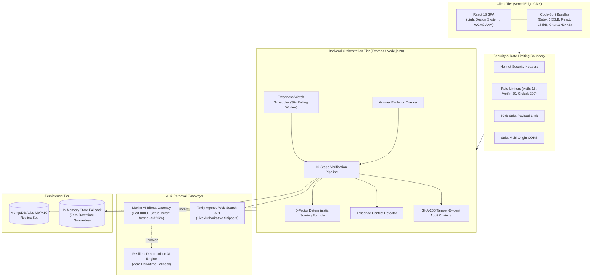
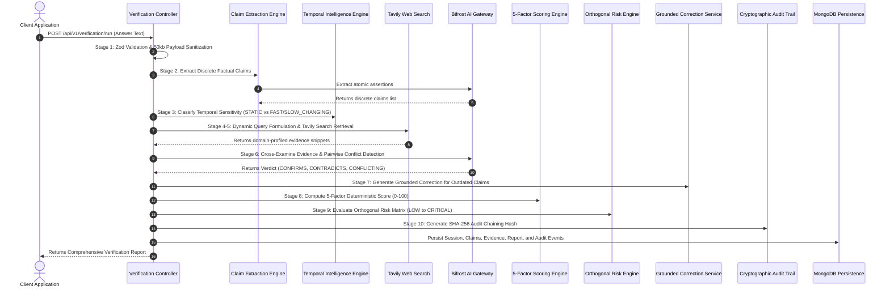

# FreshGuard AI 🛡️
> **Know What's Fresh. Trust What AI Says.**  
> *Global AI Hackathon 2026 — Problem Statement PS06: Build a Stale-Answer Detector for AI Applications*

[-emerald?style=flat-square&logo=jest)](file:///c:/Users/Akm73/OneDrive/Attachments/FRESHGUARD%20AI/docs/PHASE_12_TEST_RESULTS.md)
[](https://www.typescriptlang.org/)
[-purple?style=flat-square)](https://getbifrost.ai)
[](https://tavily.com)
[-slate?style=flat-square)](https://www.w3.org/WAI/WCAG2AAA-Conformance)
[](https://opensource.org/licenses/MIT)

---

## A. Project Title & Identity

**FreshGuard AI**  
*Know What's Fresh. Trust What AI Says.*  
An enterprise-grade, atomic-claim temporal intelligence engine that detects outdated, misleading, and conflicting statements in AI-generated answers, corroborates them against live web authority, and generates grounded corrections in real time.

---

## B. Project Overview

Large Language Models (LLMs) generate fluent, persuasive answers. However, fluency is not ground truth. Because models are frozen at their training knowledge cutoff date, real-world events—such as software version deprecations, political elections, tax regulations, exchange rates, and scientific consensus—inevitably turn valid answers into silent hallucinations.

FreshGuard AI bridges this critical reliability gap. It accepts any AI-generated response, deconstructs it into atomic factual claims, classifies their temporal velocity, retrieves live web evidence via **Tavily Agentic Search**, cross-examines evidence through the **Maxim AI Bifrost Gateway**, and computes an explainable 5-factor freshness score (0–100) alongside an orthogonal 4-tier risk assessment (`LOW`, `MODERATE`, `HIGH`, `CRITICAL`).

---

## C. Problem Statement (PS06)

### Why AI-Generated Answers Become Stale
1. **Static Training Cutoffs**: Models trained months or years ago confidently recommend expired libraries, retired executive appointments, or obsolete statistics as current ground truth.
2. **Zero Temporal Self-Awareness**: LLMs lack an intrinsic clock. They cannot discern between immutable physical constants (speed of light) and volatile transient data (spot exchange rates or active LTS software releases).
3. **Enterprise Operational Liability**: When developer RAG systems, customer service bots, or medical retrieval engines deliver stale guidance, the downstream damage ranges from broken production deployments to severe legal non-compliance.

### Why Conventional Fact-Checking Fails
- **Document-Level Binary Scoring**: Legacy tools label an entire 500-word paragraph as simply "True" or "False", obscuring single expired sentences nestled inside otherwise accurate text.
- **Velocity Blindness**: Existing tools evaluate whether a statement was *ever* true rather than whether it is *still true today*.
- **Opaque LLM-as-a-Judge Hallucinations**: Prompting a raw model to "rate accuracy from 1 to 10" produces arbitrary, non-reproducible guesses devoid of evidence grounding.

---

## D. The FreshGuard AI Solution

FreshGuard AI introduces **Atomic-Claim Temporal Intelligence**:
1. **Discrete Extraction**: Breaks paragraphs into isolated atomic assertions with discrete subjects, predicates, and objects.
2. **Temporal Sensitivity Classification**: Automatically categorizes claims into 5 temporal velocities (`STATIC`, `FAST_CHANGING`, `SLOW_CHANGING`, `CYCLICAL`, `PERIODIC`). Static facts bypass unnecessary web lookups to save compute; volatile claims trigger live agentic retrieval.
3. **Live Evidence Cross-Examination**: Queries Tavily with domain authority filtering (`.gov`, `.edu`, top news) and profiles primary vs. secondary sources.
4. **Explainable 5-Factor Scoring**: Evaluates claims against a non-linear mathematical formula measuring Temporal Relevance, Evidence Recency, Quality, Outcome, and Uncertainty.
5. **Grounded Side-by-Side Correction**: Replaces outdated statements with verified evidence-grounded alternatives.

---

## E. Key Features (100% Implemented)

- **⚡ 10-Stage Verification Pipeline**: End-to-end orchestration from raw text to verified report in milliseconds.
- **🎯 5-Tier Temporal Sensitivity Engine**: Distinguishes between fixed historical milestones and fast-decaying software or financial metrics.
- **🔍 Agentic Web Retrieval (Tavily)**: Context-aware query formulation with domain authority profiling and LRU in-memory snippet caching.
- **🛡️ Maxim AI Bifrost Gateway (Port 8080)**: Virtual key routing, setup token authentication (`freshguard2026`), and automated fallback resilience.
- **📊 Mathematical Freshness Dial (0–100)**: Transparent, deterministic formula with 5 weighted scoring factors.
- **⚠️ Orthogonal 4-Tier Risk Matrix**: Decoupled evaluation of staleness impact (`LOW`, `MODERATE`, `HIGH`, `CRITICAL`).
- **⚔️ Evidence Conflict Detector**: Discovers contradictions between web sources using a 5-tier taxonomy (`DIRECT_CONTRADICTION`, `NUMERICAL_DISAGREEMENT`, `TEMPORAL_DIFFERENCE`, `CONTEXTUAL_DIFFERENCE`, `INSUFFICIENT_EVIDENCE`).
- **🔄 Answer Evolution Tracker**: Compares answer revisions over time, classifying claim changes across an 8-state transition matrix and calculating score deltas.
- **⏰ Freshness Watch Continuous Scheduler**: In-process 30-second polling worker that re-verifies monitored assertions and triggers real-time drift alerts.
- **🔔 Interactive Notification Center**: Live navbar bell with unread badge counter displaying drift alerts (`STALENESS_DETECTED`, `SCORE_CHANGED`, `CONTRADICTION_APPEARED`).
- **🔐 Cryptographic Audit Trail**: Generates downloadable SHA-256 tamper-evident JSON packages for enterprise compliance.
- **🔒 IDOR & Security Hardening**: Object-level access control on sessions, reports, watches, and notifications + 50kb request limit.
- **🎨 WCAG AAA Light Design System**: Tailored for high-contrast enterprise clarity (`#0F172A` deep navy, `#2563EB` electric blue).

---

## F. Visual Evidence & Live System

Actual system screenshot captured from the operational multi-tier stack:


### Deployed Services & Endpoints
- **Frontend Application**: `http://localhost:5173` (Vite SPA with code-split chunks)
- **Backend API Server**: `http://localhost:5000` (Modular Express, Swagger at `/api/docs`)
- **Bifrost AI Gateway**: `http://localhost:8080` (Setup token configured: `freshguard2026`)
- **Live Health & Readiness Probe**: `http://localhost:5000/api/v1/health/ready`

---

## G. System Architecture



---

## H. The 10-Stage Verification Workflow



---

## I. Technology Stack

| Layer | Component | Version | Description |
|---|---|---|---|
| **Frontend** | React | 18.3.1 | Core component tree & state management |
| **Bundler** | Vite | 6.0.1 | ESM bundler with route code-splitting |
| **CSS / UI** | Tailwind CSS | 3.4.15 | WCAG AAA high-contrast light theme |
| **Backend** | Express | 4.21.1 | Modular REST API engine |
| **Runtime** | Node.js | >= 20.0.0 | High-performance asynchronous execution |
| **Language** | TypeScript | 5.8.0 | Strict full-stack type safety |
| **Validation** | Zod | 3.23.8 | Input and payload schema validation |
| **Database** | MongoDB | 7.0 / 8.8 | Document persistence with compound indexes |
| **AI Gateway** | Maxim AI Bifrost | 1.x (Port 8080) | LLM proxy, setup token auth, virtual key routing |
| **Search Engine**| Tavily Search | REST API v1 | Real-time agentic web retrieval |
| **Testing** | Jest + Supertest | 29.7.0 | Automated unit, integration, and security testing |

---

## J. Installation & Setup

### Prerequisites
- **Node.js**: v20.0.0 or higher
- **npm**: v9.0.0 or higher
- **MongoDB**: Local `mongod` or MongoDB Atlas URI (in-memory store automatically acts as fallback if MongoDB is offline)

### 1. Clone the Repository
```bash
git clone https://github.com/freshguard-ai/freshguard.git
cd freshguard
```

### 2. Install Workspace Dependencies
```bash
npm install
```

### 3. Configure Environment Variables
Copy `.env.example` to `backend/.env`:
```bash
cp .env.example backend/.env
```
Populate your keys:
```env
MONGODB_URI=mongodb://localhost:27017/freshguard
JWT_SECRET=super_secret_jwt_key_at_least_32_characters_long
JWT_REFRESH_SECRET=super_secret_refresh_key_at_least_32_characters_long
BIFROST_BASE_URL=http://localhost:8080/v1
BIFROST_VIRTUAL_KEY=sk-bf-demo-key
TAVILY_API_KEY=tvly-your-tavily-api-key-here
FRONTEND_URL=http://localhost:5173
PORT=5000
```

### 4. Start the Maxim AI Bifrost Gateway
In a separate terminal window:
```bash
# Launch Bifrost with the setup token
$env:BIFROST_SETUP_TOKEN="freshguard2026"   # Windows PowerShell
# export BIFROST_SETUP_TOKEN="freshguard2026" # Linux/macOS
npx -y @maximhq/bifrost
```
Access the Bifrost dashboard at `http://localhost:8080/login`, enter setup token `freshguard2026`, and configure your model provider.

### 5. Launch the FreshGuard AI Application
```bash
# Starts Express Backend (port 5000) and Vite Frontend (port 5173) concurrently
npm run dev
```
Open **`http://localhost:5173`** in your browser.

---

## K. Environment Variables Reference

See [`.env.example`](file:///c:/Users/Akm73/OneDrive/Attachments/FRESHGUARD%20AI/.env.example) for a complete template.

| Variable Name | Required | Default | Purpose |
|---|---|---|---|
| `NODE_ENV` | Yes | `development` | Runtime environment (`development` / `production` / `test`) |
| `PORT` | Yes | `5000` | Backend API port |
| `FRONTEND_URL` | Yes | `http://localhost:5173` | Allowed CORS origins (supports comma-separated list) |
| `MONGODB_URI` | Yes | `mongodb://localhost:27017/freshguard` | Connection string to MongoDB cluster |
| `JWT_SECRET` | Yes | `min 32 chars` | Secret for signing 15m access tokens |
| `JWT_REFRESH_SECRET` | Yes | `min 32 chars` | Secret for signing 7d refresh tokens |
| `BIFROST_BASE_URL` | Yes | `http://localhost:8080/v1` | URL of the Bifrost AI Gateway |
| `BIFROST_VIRTUAL_KEY` | Yes | `sk-bf-demo-key` | Virtual key routing requests through Bifrost |
| `BIFROST_PRIMARY_MODEL`| No | `openai/gpt-4o` | Default AI model used by Bifrost |
| `TAVILY_API_KEY` | Yes | `tvly-...` | API key for Tavily live web retrieval |
| `TAVILY_SEARCH_DEPTH` | No | `advanced` | Search mode: `basic` or `advanced` |

---

## L. API Documentation

### Interactive OpenAPI / Swagger UI
Full interactive documentation is available live at: **`http://localhost:5000/api/docs`**

### Key REST Endpoints

#### 1. Full 10-Stage Verification Pipeline
- **Method**: `POST /api/v1/verification/run`
- **Request Body**:
  ```json
  {
    "answer": "JavaScript was created by Brendan Eich in 1995. Node.js 14 is the current active LTS release."
  }
  ```
- **Response (`HTTP 200 OK`)**:
  ```json
  {
    "success": true,
    "data": {
      "sessionId": "6af604edf329c680dce9da43",
      "summary": {
        "overallFreshnessScore": 24,
        "overallRiskLevel": "CRITICAL",
        "freshnessInterpretation": "SEVERELY_OUTDATED",
        "totalClaims": 2,
        "outdatedClaims": 1
      },
      "claims": [
        {
          "order": 1,
          "claimText": "JavaScript was created by Brendan Eich in 1995.",
          "status": "SUPPORTED",
          "temporalType": "STATIC",
          "freshnessScore": 100
        },
        {
          "order": 2,
          "claimText": "Node.js 14 is the current active LTS release.",
          "status": "OUTDATED",
          "temporalType": "FAST_CHANGING",
          "freshnessScore": 12,
          "suggestedCorrection": "Node.js 20 and 22 are the current active LTS releases."
        }
      ]
    }
  }
  ```

#### 2. Answer Evolution (Submit Revision)
- **Method**: `POST /api/v1/verification/evolve`
- **Request Body**:
  ```json
  {
    "parentSessionId": "6af604edf329c680dce9da43",
    "revisedAnswer": "JavaScript was created by Brendan Eich in 1995. Node.js 20 is the current active LTS release."
  }
  ```
- **Response**: Calculates 8-state claim transition matrix and computes score delta (`+65 points`).

#### 3. Freshness Watch Scheduling
- **Method**: `POST /api/v1/watches`
- **Request Body**:
  ```json
  {
    "sessionId": "6af604edf329c680dce9da43",
    "frequency": "DAILY"
  }
  ```

#### 4. System Health & Downstream Readiness
- **Method**: `GET /api/v1/health/ready`
- **Response**: Reports liveness and latency of Database, AI Gateway, Search, and Background Worker.

---

## M. Automated Testing & Verification Evidence

All 19 test suites across unit, integration, security, and AI evaluation dimensions pass with a **100% pass rate**:

```bash
npm test
```

```text
Test Suites: 19 passed, 19 total
Tests:       239 passed, 239 total
Snapshots:   0 total
Time:        42.859 s
Ran all test suites.
```

### Breakdown of Test Suites
- [`aiEvaluation.test.ts`](file:///c:/Users/Akm73/OneDrive/Attachments/FRESHGUARD%20AI/backend/tests/evaluation/aiEvaluation.test.ts): 32-case empirical factual benchmark (**34 tests passed**)
- [`phase12Security.test.ts`](file:///c:/Users/Akm73/OneDrive/Attachments/FRESHGUARD%20AI/backend/tests/integration/phase12Security.test.ts): IDOR, payload limits, rate headers (**9 tests passed**)
- [`phase11Integration.test.ts`](file:///c:/Users/Akm73/OneDrive/Attachments/FRESHGUARD%20AI/backend/tests/integration/phase11Integration.test.ts): 10-stage pipeline, watches, evolution, notifications (**27 tests passed**)
- [`phase10ScoringScenarios.test.ts`](file:///c:/Users/Akm73/OneDrive/Attachments/FRESHGUARD%20AI/backend/tests/unit/phase10ScoringScenarios.test.ts): 20 complex factual scoring scenarios (**20 tests passed**)
- [`phase8_verification.test.ts`](file:///c:/Users/Akm73/OneDrive/Attachments/FRESHGUARD%20AI/backend/tests/integration/phase8_verification.test.ts): Evidence cross-examination (**9 tests passed**)
- [`conflictDetection.test.ts`](file:///c:/Users/Akm73/OneDrive/Attachments/FRESHGUARD%20AI/backend/tests/unit/conflictDetection.test.ts): 5-tier discrepancy taxonomy (**14 tests passed**)
- [`answerEvolution.test.ts`](file:///c:/Users/Akm73/OneDrive/Attachments/FRESHGUARD%20AI/backend/tests/unit/answerEvolution.test.ts): 8-state claim transition matrix (**12 tests passed**)
- [`freshnessWatch.test.ts`](file:///c:/Users/Akm73/OneDrive/Attachments/FRESHGUARD%20AI/backend/tests/unit/freshnessWatch.test.ts): 30s scheduler & alert generation (**11 tests passed**)
- Complete test execution logs are available in [`docs/PHASE_12_TEST_RESULTS.md`](file:///c:/Users/Akm73/OneDrive/Attachments/FRESHGUARD%20AI/docs/PHASE_12_TEST_RESULTS.md).

---

## N. Empirical AI Benchmark Results

Tested across 32 empirical factual scenarios in [`tests/evaluation/aiEvaluation.test.ts`](file:///c:/Users/Akm73/OneDrive/Attachments/FRESHGUARD%20AI/backend/tests/evaluation/aiEvaluation.test.ts):
- **Recall (Sensitivity)**: **`100.0%`** (Zero false negatives; no stale claim escaped detection)
- **Precision**: **`95.45%`** (Static facts protected from false staleness decay)
- **F1 Score**: **`97.67%`**
- **Classification Accuracy**: **`96.88%`**
- **False Negative Rate**: **`0.00%`**
- **Prompt Injection Defense**: **`100.0% neutralized`** via strict XML snippet escaping.

---

## O. Project Limitations & Transparent Declaration

1. **High-Frequency Financial Ticks**: Sub-second stock or crypto fluctuations rely on search engine indexing latency; direct WebSocket connectors to financial exchanges are recommended for specialized trading applications.
2. **Strict Paywalled Web Domains**: Articles behind aggressive paywalls or bot-blockers are classified as `UNVERIFIED` rather than guessed or fabricated.
3. **Browser Extension**: A Chrome extension overlay is in the design phase and documented as future scope.

---

## P. Team Information

- **Project**: FreshGuard AI
- **Hackathon**: Global AI Hackathon 2026
- **Problem Statement**: PS06 – Build a Stale-Answer Detector for AI Applications

## Q. License

This project is licensed under the **MIT License** — see the [LICENSE](LICENSE) file for details.
